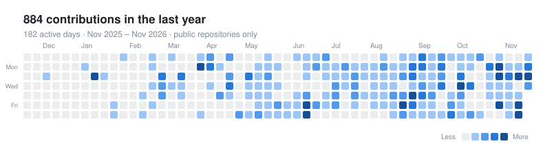

<div align="center">

# Ton Llop

Infrastructure, DevOps and local AI · final-year engineering student in Tarragona

**[tonllop.dev](https://tonllop.dev)** · [LinkedIn](https://www.linkedin.com/in/antoni-llop/) · [tonichi003@gmail.com](mailto:tonichi003@gmail.com)

*Every system fails eventually. The craft is in what happens next.*

</div>

## Status

```console
$ systemctl status ton
● ton.service - Antoni Llop, infrastructure and local AI
     Loaded: loaded (/tarragona/urv; final year, graduating Feb 2027)
     Active: active (running), open to internships
     Speaks: catalan, spanish, english, a little german
     CGroup: /homelab/proxmox
             ├─ jaull        finding the local LLM your machine can actually run
             ├─ lipopotamo   NMR pipelines at Biosfer Teslab
             └─ containers   always one more

```

## Expeditions

| | |
|---|---|
| [**Jaull**](https://jaull.tech) | Reads your hardware, recommends which local LLM will fit, then runs and benchmarks it to check. [repo](https://github.com/Ton-Llop/Jaull) |
| **Server to Cluster** | A Debian server run as code, then the same discipline on Kubernetes with Terraform, NetworkPolicies and Prometheus/Grafana. [server](https://github.com/Ton-Llop/Debian-Config) · [cluster](https://github.com/Ton-Llop/GSX-Infrastructure) |
| **Ticket service** | RabbitMQ workers on AWS ECS Fargate that scale with the queue backlog, with retries, dead-letter queues and benchmarks. [repo](https://github.com/Ton-Llop/Scalable-and-Elastic-Ticket-Service-AWS-Managed-Systems-) |
| **Lipopotamo** | Scientific NMR platform at Biosfer Teslab: async workers, execution history and partial re-runs behind Keycloak. Private. |
| **Ninjadorks** | Search automation for authorized security research, with JSON/HTML reports and regex analysis. [repo](https://github.com/Ton-Llop/Google-Dorks) |
| **Beer Fantasy** | Fantasy leagues for nights out with friends. Flutter and Supabase, live on [Google Play](https://play.google.com/store/apps/details?id=com.ton.beerfantasy). |
| **Homelab** | An old desktop running Proxmox, Pi-hole and a power monitor, mostly so I can break things safely. [repo](https://github.com/Ton-Llop/Homelab) |
| **DD-tmux** | My AI coding agents as a Darkest Dungeon party, one torch-lit room per tmux session. [repo](https://github.com/Ton-Llop/DD-tmux) |

The rest, from a MIPS CPU in Verilog to the coursework, is on [tonllop.dev](https://tonllop.dev).

## Inventory

<table>
<tr><td><sub>Infra</sub></td><td>&nbsp;&nbsp;&nbsp;&nbsp;&nbsp;&nbsp;&nbsp;&nbsp;&nbsp;&nbsp;&nbsp;&nbsp;&nbsp;&nbsp;&nbsp;&nbsp;&nbsp;&nbsp;</td></tr>
<tr><td><sub>Watch &amp; guard</sub></td><td>&nbsp;&nbsp;&nbsp;&nbsp;</td></tr>
<tr><td><sub>Backend &amp; data</sub></td><td>&nbsp;&nbsp;&nbsp;&nbsp;&nbsp;&nbsp;&nbsp;&nbsp;&nbsp;&nbsp;&nbsp;&nbsp;&nbsp;&nbsp;&nbsp;&nbsp;</td></tr>
<tr><td><sub>Local AI</sub></td><td>&nbsp;&nbsp;</td></tr>
<tr><td><sub>Front &amp; mobile</sub></td><td>&nbsp;&nbsp;&nbsp;&nbsp;&nbsp;&nbsp;&nbsp;&nbsp;&nbsp;&nbsp;&nbsp;&nbsp;</td></tr>
<tr><td><sub>Down low</sub></td><td>&nbsp;&nbsp;</td></tr>
</table>

## Torchlight

<picture>
  <source media="(prefers-color-scheme: dark)" srcset="https://raw.githubusercontent.com/Ton-Llop/Ton-Llop/main/activity-dark.svg" />
  <source media="(prefers-color-scheme: light)" srcset="https://raw.githubusercontent.com/Ton-Llop/Ton-Llop/main/activity-light.svg" />
  
</picture>

Looking for an internship in infrastructure, DevOps or backend. If that's you, the torch is lit: [write to me](mailto:tonichi003@gmail.com).
